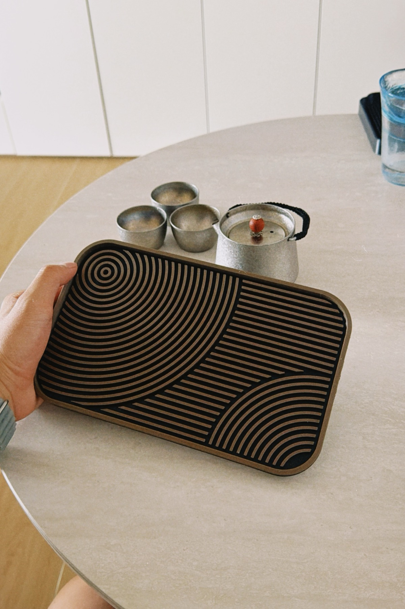
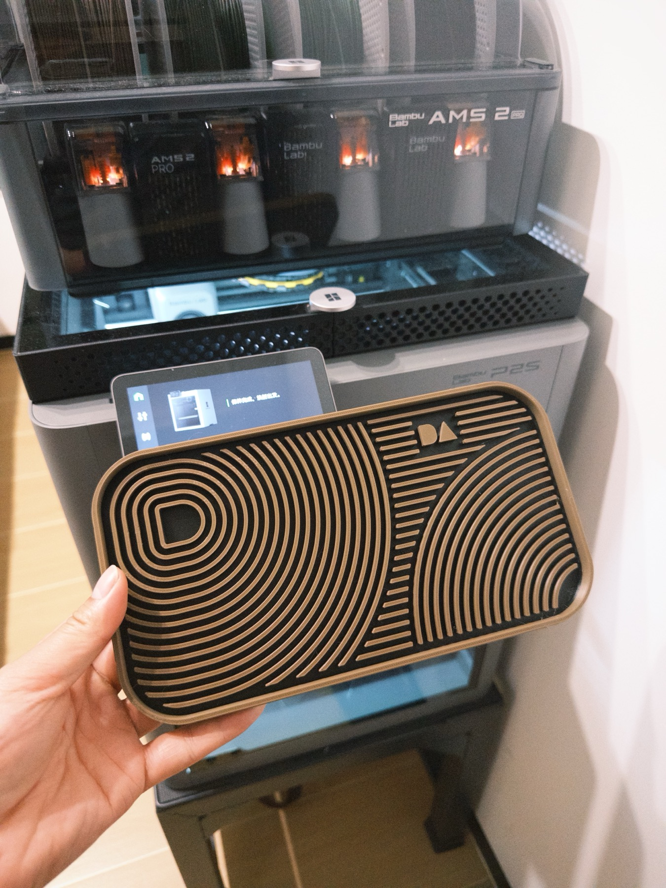
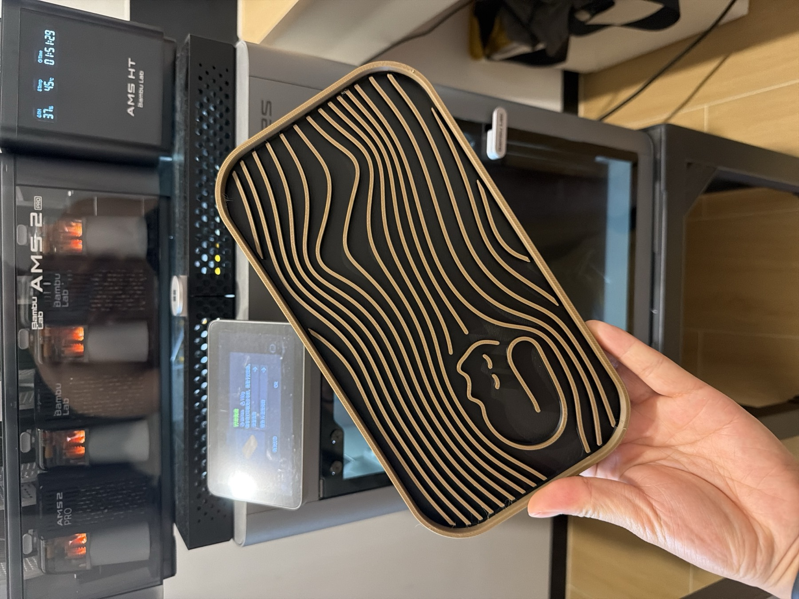
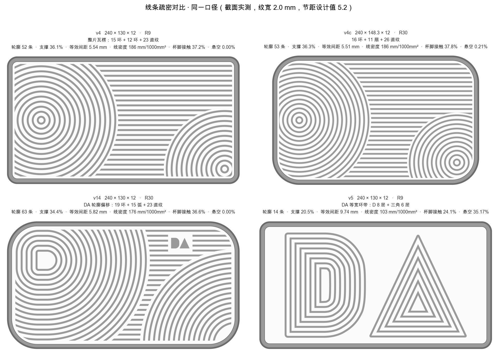
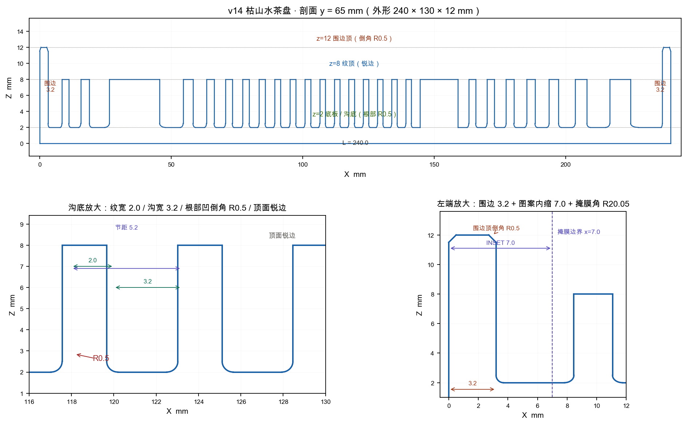
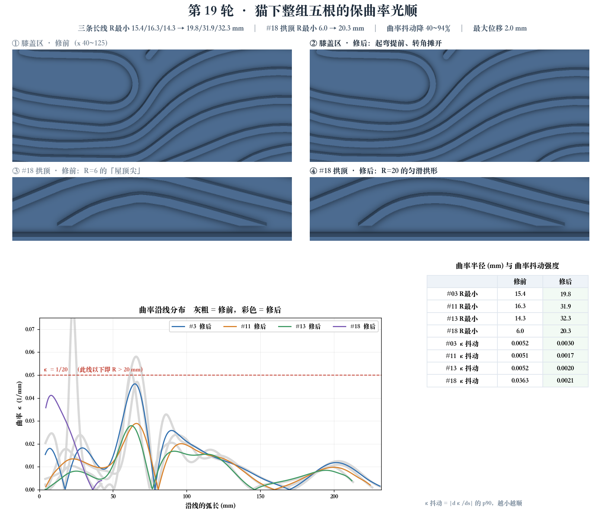
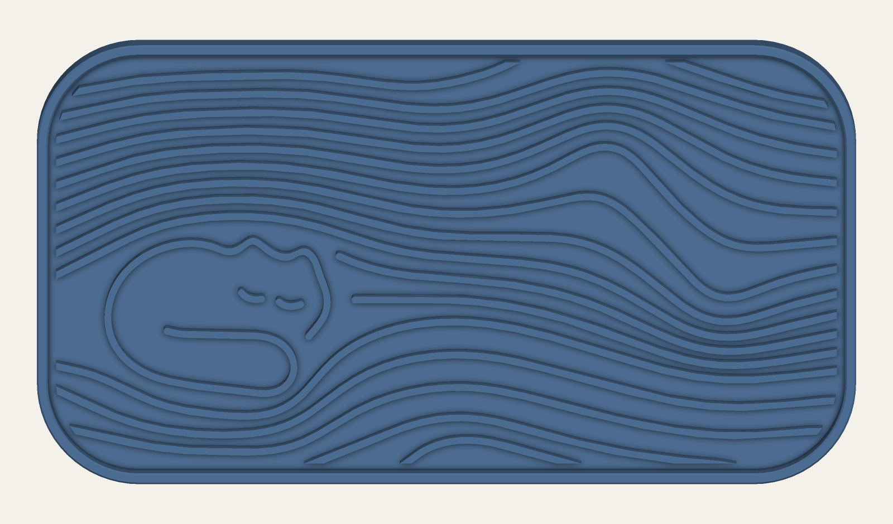

# Tea Tray Maker · 可打印茶盘生成 Skill

把自然语言描述、参考图和杯具需求转成对应的茶盘外形、布局与纹理，生成参数化模型并检查打印可行性。适用于支持 `SKILL.md` 的 agent。

## 从一句描述，到桌上的茶盘

你可以描述想要的形状、放哪些杯子、喜欢什么纹理，也可以给一张参考图。Skill 帮助 agent 把这些想法拆成可修改的几何结构，生成模型，再根据你的反馈调整。

下面是本项目历史迭代中的三款实物。它们展示这套方法的来源；你的设计可以从自己的描述出发。

<table>
<tr>
<td width="33%"></td>
<td width="33%"></td>
<td width="33%"></td>
</tr>
<tr><td align="center">波纹与几何构图</td><td align="center">字母专属设计</td><td align="center">小猫与自由曲线</td></tr>
</table>

*以上三张均为作者提供的真实打印成品照片。照片展示外观，不代表每个版本都经过完整的容量、耐温或防漏测试。*

## 它怎样帮你把想法做出来

### 1. 比较布局，而不是只给一张效果图

外形比例、圆角和纹理疏密一起影响视觉与可用空间。下面的历史对比把多个方案放在同一视角下，帮助决定哪些部分保留、哪些部分继续修改。



*历史几何分析图。图中接触率等数值基于当时的杯脚假设与采样，不是实物稳定性测量，也不是所有茶盘的默认参数。*

### 2. 把外观落实为结构

“储水更多”“纹理高一点”需要转成明确的结构变化。剖面图将底板、承杯纹理、围边和沟宽分开表示，便于检查改动有没有影响其他部分。



*历史模型结构分析，尺寸仅属于该案例。新设计按杯具、外形和打印约束重新确定。*

### 3. 根据反馈细修，并保留已经喜欢的部分

比如“猫下面的线不够顺”，应调整对应曲线及邻线间距，保持猫咪轮廓和整体构图。下面保留了当时的修改前后对比，展示从视觉反馈到局部几何调整的过程。



*历史第 19 轮模型分析图；图中的改进数值针对这一轮曲线计算。*



*历史模型预览，用于说明图案与背景线族的组合。它与上方实拍属于同一设计系列，不据此认定两张图对应完全相同的打印文件版本。*

这些过程沉淀为可复用的方法：理解需求、拆分几何层、保持沟宽和曲线连续、检查支撑与结构、按反馈局部修改。最终交付可编辑源码、STEP/STL、模型预览与检查结果；具备切片环境时再生成并验证打印工程。

## 包含什么

- 从描述到几何的设计流程：按需求创建外轮廓、储水结构、承杯布局与纹理。
- 可选波纹生成器：导出 STEP、STL、尺寸及几何容量报告。
- STL 检查与实际模型预览脚本。
- 从多轮真实修改提炼的方法：图案避让、等距留沟、曲线光顺、边缘收口、支撑与外观取舍。
- 局部修改与版本管理：保留已确认设计，检查修改是否影响其他结构。
- Bambu Studio 切片检查及真实打印问题的排查方法。
- 与 [MakerWorld Uploader](https://github.com/Crazypeter0801/makerworld-uploader) 的素材交接规则。

Skill 指导 agent 为具体描述创建或修改 CAD 源码并验证结果；不限定为 DA、小猫或波纹款式。附带 CLI 直接支持波纹基线，其他形状需要 agent 实现对应几何，不能仅靠替换一个文字参数生成。

## 安装与使用

将仓库放到 agent 的 skills 目录，文件夹名保持 `tea-tray-maker`。Codex 示例：

```bash
git clone https://github.com/Crazypeter0801/tea-tray-maker.git ~/.codex/skills/tea-tray-maker
```

若已有同名目录，先保留现有内容，不直接覆盖。

可以这样说：

> 用 tea-tray-maker 根据这张图做一个能放飘逸杯和小茶杯的茶盘。先确认杯具摆位，再生成模型。

> 给同事做一个带字母标记的专属茶盘，背景纹理避开标志，保留统一沟宽。

> 做一个眠猫流水纹茶盘，保留猫咪的简洁轮廓，检查杯脚放在猫身附近是否稳定。

实际依赖、运行命令及验收步骤见 [SKILL.md](SKILL.md)。

## 验证状态

默认240×148.3×12mm和改参220×140×13mm两组模型完成本地生成、实体/网格检查与预览；5项回归测试通过。DA/猫咪部分为历史源码与报告提炼，以上实拍由作者提供；本次 Skill 整理未重新构建或试印这两款。网格水密不代表打印件不漏水，切片通过不代表实物试印通过。

默认交付可编辑模型和检查结果；创建打印工程需实际切片软件及用户机型信息，不自动发送打印、发布模型或发文章。
