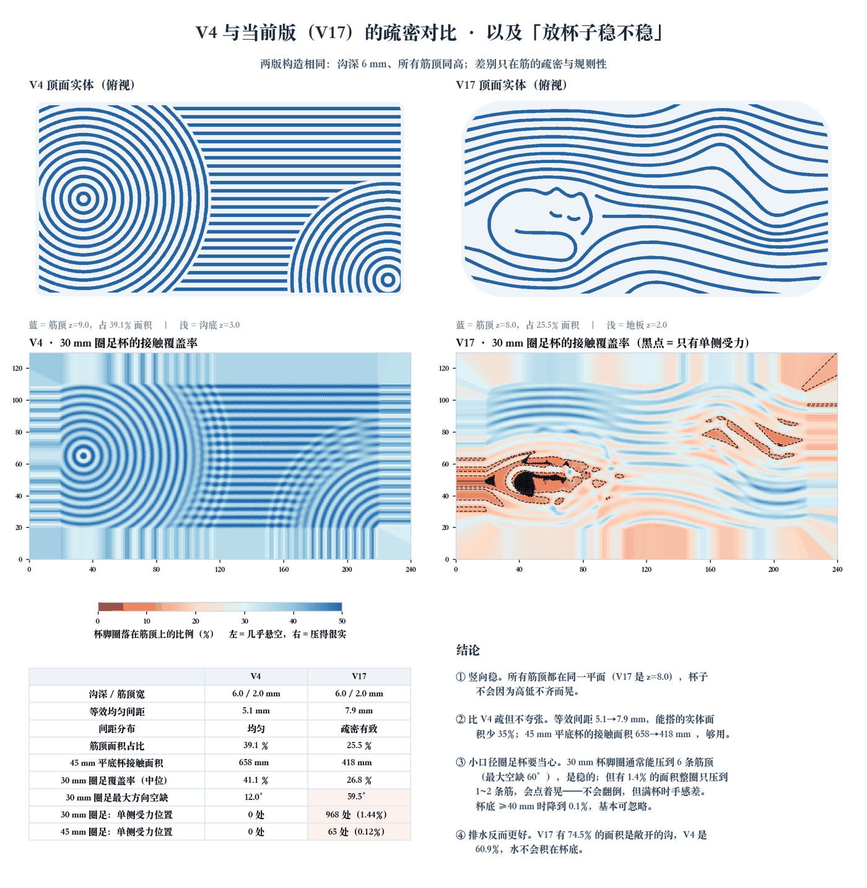
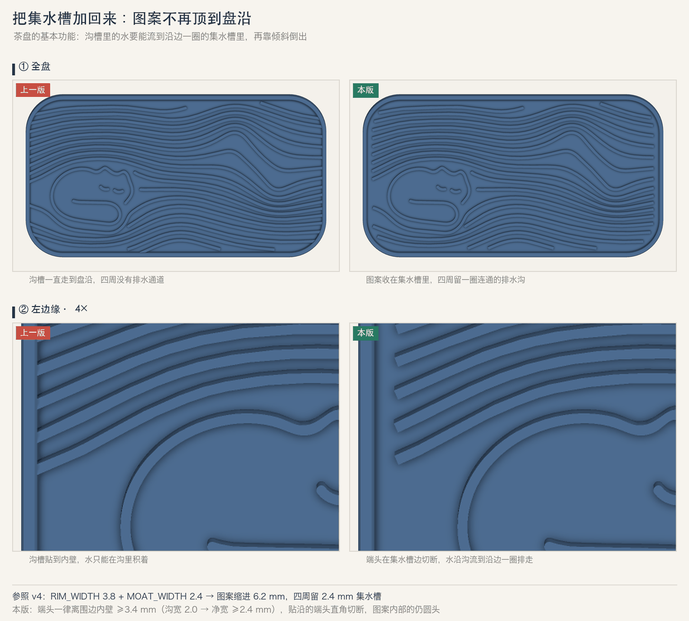
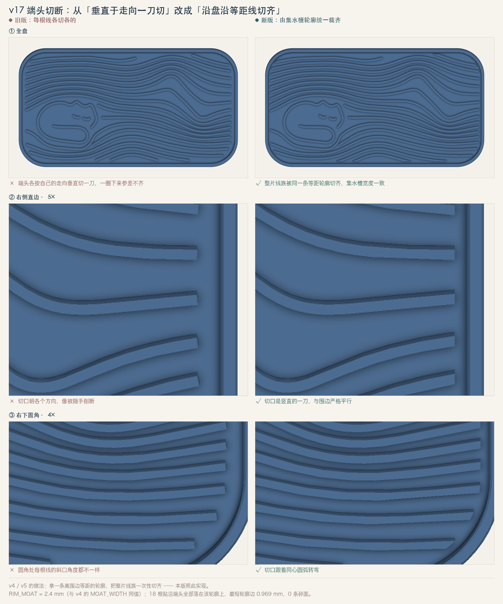

# 建模规则与适用边界

## 尺寸、杯具和储水

示例为一只飘逸杯与一只小茶杯设计，但历史 `cup_sizes_confirmed=false`，不能把示例当作所有杯子的适配标准。布局需同时考虑杯底接触、杯腹、把手、杯间距离和取放空间。圆环杯脚与平底杯的支撑条件不同；局部接触分布比全盘支撑率更重要。旧稳定性报告使用假设 30mm 杯脚和采样近似，不是实际杯具稳定性证明。

分开定义底厚 floor、筋高 rib_height、总高 height。承杯平面 Z = floor + rib_height，围边要更高。脚本容量是指定绝对 Z 水位以下空腔的 CAD 布尔体积，单位 mL；不含杯具浸入排水量，也不证明各槽连通或打印件水密。

不要单纯把底板减薄来增容；这会改变刚度和首层/翘曲表现。若用户坚持减薄，应生成新版本，重新切片和试水。

## 纹理规则

净沟宽 = 中心距 − 筋宽。环组和直筋组为填满边界，可能重新均分间距，应报告 actual_pitch 而不是只报名义 PITCH。v4i 示例环组 5.5mm，直筋约 5.5375mm；对应净沟约 3.3/3.3375mm。

组间过渡带由两个遮罩共同决定，不等于变量 SEP 本身。当前种子公式为：分隔沟 = 2 × SEP + 0.2mm，故 SEP = (净沟宽 − 0.2)/2；遮罩半径与分隔量分开管理。该公式只适用于当前代码，不推广到所有茶盘。

圆心与盘角圆弧关系影响纹理是否被切成薄片。当前左圆心接近左上圆角中心，右扇圆心接近右下外角，得到大扫弧。调整盘比例后还要看截断区域，不以数值合法代替视觉审查。

保留筋片时，种子使用顶面面积阈值过滤小碎片；这个规则不测量所有局部厚度。进一步检查窄端、尖角、与底板接触及切片中的孤岛。等宽直壁比锥形筋更容易解释线宽，但不保证所有材料都会融合良好。

## 筋宽：先对齐挤出线，再定美观

筋宽不仅是视觉参数。等宽直壁筋在切片里会被拆成若干根料；筋宽落在两个“整数根料”宽度之间时，slicer 会把余量全塞给正中那根，实物上表现为筋顶中线或被带起的细线。新设计先跑 `scripts/rib_width.py --layer <层高> --suggest` 选宽度，再定中心距；默认的 2.2 mm 只用于复现历史 v4i，在 0.12 层高下正中会被撑宽 25%。0.12 层高、0.4 喷嘴默认线宽时，1.66–1.74 mm（4 根）与 2.51–2.58 mm（6 根）是校准过的区间。细节和对照数据见 [切片与实物验证](slicing.md)。

改筋宽会同时改变杯脚接触和储水：同样 5.5 mm 中心距，筋 2.58 → 接触中位 47.5%、容量 108 mL；筋 1.70 → 32.1%、137 mL。把这两项一起报给用户再选。

## 杯脚稳定性



“筋顶面积占比”不能代表杯子稳不稳：同样 25% 的筋顶，均匀直纹处处稳，猫咪图案的留白区却可能只有 1–2 根筋托住杯脚。用 `scripts/cup_stability.py` 在真实 STL 上逐点检查：

```bash
python <skill>/scripts/cup_stability.py <project>/output/tea_tray.stl --out-dir <project>/output \
  --foot 30 --foot 45:flat --at 60,90
```

- 圈足（`--foot 30`）：只看直径 30 mm 的细圆环压在哪些筋上；平底（`--foot 45:flat`）看整个圆面。
- `one_sided`：所有支撑点都落在半圈以内（最大无支撑角 ≥ 180°），重心不在支撑范围内，杯子会往空的一侧歪。热力图上画成黑点。
- `--at x,y` 检查用户指定的摆杯位置；把用户真实杯脚直径代进去，不用 30 mm 当默认事实。
- 该判据只看几何，不含摩擦、杯重分布、筋顶打印误差。用它比较方案和找危险区，“能不能放”最终靠实物。

历史数据（同一脚本）：v4i 波纹 30 mm 圈足 0 处单侧受力、接触中位 40.8%；v19 猫咪 123 处（2.66%）集中在猫身留白，45 mm 平底则 0 处。此前给猫区加密回声线（v20 A 方案）指标更好，但用户否决了造型 —— 指标只用于展示取舍，不自动替用户改图案。

## 集水槽与端头收口



茶盘的基本功能是把沟里的水引到沿边一圈集水槽，再整盘倾斜倒出。图案沟槽一直顶到内壁时，水只能积在各自的沟里。做法：从围边内壁向内统一留一圈集水槽（v4：围边 3.8 + 集水槽 2.4 mm，图案缩进 6.2 mm），所有纹理在这条等距轮廓上截断。



贴边的端头不要按每根线自己的走向垂直切一刀（切口方向各异、像随手剪断），而是让整片线族越过等距轮廓后一次性裁齐，圆角处切口自然跟着同心弧转。内部装饰端头仍用圆头收笔，不要一起拉到围边。该轮修改记录 18 根贴沿端头全部落在该轮廓上，最短轮廓边 0.969 mm、0 条碎面（后续 v19 为 17 根，距内壁 2.4 mm）。

## 导出

CAD 曲线优先保留圆弧/圆柱，STL 只是离散输出。种子的绝对线性容差 0.01mm、角容差 0.03rad 来自本案例；按曲率和文件体积调整，不追求最高面数。STEP 与 STL 的包围盒和体积应接近；检查脚本默认尺寸差 ≤0.05mm、体积相对差 ≤0.5%，这是本 Skill 的验证阈值，不是打印机精度承诺。
