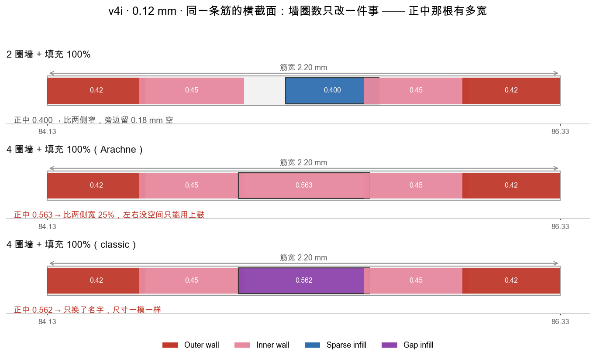
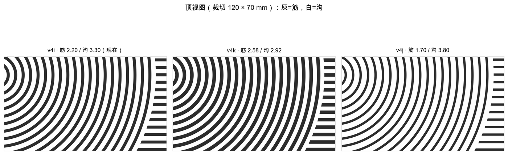
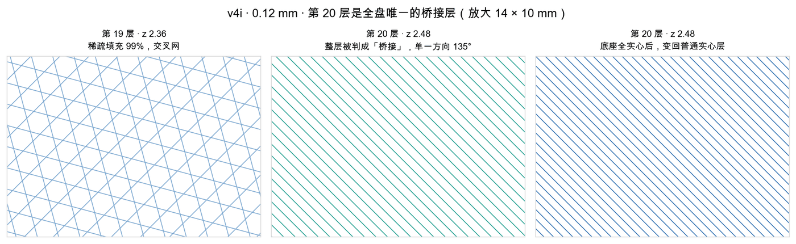

# 切片与实物验证

## 创建工程

使用当前安装的切片软件和真实打印机、喷嘴、耗材、板型。沿用用户已确认的官方预设作为起点；不要从某一案例复制温度、速度和流量到所有耗材。先在盘面检查模型、brim、擦料塔、排除区与机型可用区域，不能只检查模型的长宽是否小于标称床尺寸。

导入 STEP/STL，底面朝下；确认尺寸和支撑需求。让 Studio 创建打印工程并保存 3MF。通用几何 3MF 与含机型/耗材/过程设置的打印工程不是同一种交付；不要改扩展名或只塞网格冒充已切片工程。

保存后重新打开、重新切片，核对全局、对象覆盖、零件/修改器三个层级。有同名设置时实际生效值可能不来自全局。直接编辑 ZIP 内配置的工程尤其需要 GUI 重开另存验证。切片 CLI 的调用参数先读当前 `--help`，不硬套旧版本。

**换预设会连带重置参数。** 历史上清料槽/换耗材时，工艺预设从 `0.20mm High Quality` 掉回 `Standard`，填充 40% gyroid 变成 15% grid，肉眼很难发现。每次换机型、耗材或工艺预设后，重新读 3MF 里的 `Metadata/project_settings.config`，与上一版逐项比对层高、墙数、填充密度/图案、顶底层数。

## 必看的层和路径

1. 首层：连续附着、边缘和孤岛。
2. 底板中层：是否因上方筋投影被分割成碎片路径。
3. 底板最后一层（筋开始之前）：线条类型是不是 `Bridge`（见下文“桥接层”）。
4. 筋刚出现、筋中段和筋顶：墙线、窄缝补线、短折返和顶面填充。
5. 外边框与纹理交界：平行墙线之间是否存在过碎补线、意外悬空或缺失。

按线条类型及线宽看实际结果，而非只看模型渲染。两道墙是轮廓每侧的墙数，不代表整条筋总共两条挤出线。预览层号与 G-code 层序号差 1（预览第 N 层 = 第 N−1 个 `; CHANGE_LAYER`，首层算第 1 层）。

## 实测结论一：筋宽要接近“整数根料”



现象：筋顶中间一条细线、或打印中筋的中线被喷嘴带起。v4i（筋宽 2.2 mm，0.12 层高，外墙 0.42 / 内墙 0.45）在筋中段做竖向剖切，每根筋被切成 **0.420 / 0.450 / 0.563 / 0.450 / 0.420** 五根料：正中那根被 slicer 撑宽 25% 去填两侧内墙之间 0.512 的缝，并向两侧各挤进 0.026 mm —— 这两道接缝就是实物上的细线。

以下参数都**实测无效**（横截面逐根不变或更糟），不要再当成修法：

| 尝试 | 结果 |
|---|---|
| 墙圈数 2 → 3 → 4（Arachne / Classic） | 正中仍是 0.563 / 0.562，只是线条类型从 Inner wall 变成 Gap infill |
| 1 圈墙 | 正中变成 3 根 0.40 稀疏线挤在一起，更糟 |
| `infill_wall_overlap` 15% → 0% | 一个数字都不变 |
| `internal_solid_infill_line_width` 0.42 → 0.50 | 不变 |
| `detect_thin_wall` | 4 圈墙下完全不起作用 |
| 全局线宽 0.44 | 正中 0.543，变窄但没消失 |
| 稀疏填充线宽 0.51 | 筋没问题了，但 3.8 mm 围边中间留出 0.32 mm 空隙 —— 改全局线宽会连带改所有特征 |

根治：改**几何**而不是参数，让筋宽 ≈ 整数根料。先用脚本预测：

```bash
python <skill>/scripts/rib_width.py --layer 0.12 --check 2.2 --check 3.8 --suggest
```

模型：相邻料重叠 k = 层高 × (1 − π/4)，N 根料铺满宽度 = 2·外墙 + (N−2)·内墙 − (N−1)·k；多出来的宽度全部摊给正中的料。用三组切片校准，预测与实测差 < 0.002 mm：



| 版本 | 筋 / 沟 (mm) | 横截面实测 (mm) | 0.12 层全实心时长 | 材料 | 几何容量@z9 | 30 mm 圈足接触中位 |
|---|---|---|---|---|---|---|
| v4i | 2.20 / 3.30 | 0.420/0.450/**0.563**/0.450/0.420 | 29.5 h | 200.6 mL | 120.7 mL | 40.8% |
| v4k | 2.58 / 2.92 | 0.420/0.450/0.484/0.484/0.450/0.420 | 30.9 h | 213.2 mL | 108.1 mL | 47.5% |
| v4j | 1.70 / 3.80 | 0.420/0.469/0.469/0.420 | 26.6 h | 184.2 mL | 137.2 mL | 32.1% |

（时长为 A1 / 0.4 喷嘴 / PLA 的切片估算；接触率来自 `cup_stability.py`。）v4k、v4j 都没有补缝线，过量被摊到中间两根（+7.5% / +4.2%）。代价是取舍：v4k 更稳、储水少；v4j 更省料更快、储水多，但杯脚接触降到 32%。相邻料之间的浅接缝是 FDM 固有的，完全压平只能靠熨烫。**v4k/v4j 只有切片验证，没有实物试印回报**；0.2 层高下的推荐宽度是公式外推，换层高后要重新切片核对。

围边宽度同理：3.8 mm 在 0.12 层高下 ≈ 9 根料（中间仅 +3.6%），在 0.2 层高下中间那根会被撑宽 34%。

另一条历史试验是从线宽一侧凑整：Arachne + 两道墙 + 内外墙名义 0.55 mm，让 2.2 mm 筋排成 4 根料（工程 `v4i_rib_4lines_studio.3mf`），切片上同样没有补缝线，但全局线宽会同时改变围边和底板的排线，也没有实物通过回报。若实物仍有缝或抬线，还要排查耗材受潮、流量、首层粘结和喷嘴粘料，不能都归到筋宽。仅关闭窄内部实心检测（`only_disable_narrow_detection`）曾仍保留分区，且对象覆盖/修改器会让 GUI 重开后的效果与 CLI 不同 —— 以 GUI 另存再重开的结果为准。

## 实测结论二：底座最后一层被判成“桥接”



3 mm 底座 + 99% 稀疏填充时，底座顶面实心区的第一层（0.2 首层 + 0.12 层高时为第 20 层，z=2.48）压在稀疏网上，被 slicer 判为**内部桥接**：全盘单一方向 135°、低速、风扇在 0/255 之间反复切换。它下面只有稀疏线的交叉点支撑，是全盘粘得最弱的一层。

- 自检：在预览中点底座最后几层，线条类型出现 `Bridge` → 这份工程的底座并不是真的实心。
- 修法 1：`bottom_shell_layers` 覆盖整个底座（3 mm、首层 0.20、其余 0.12 时需 ≥ 24 层，取 25 更稳）。桥接层消失，时间 33.9 h → 32.3 h（实心 monotonic 比 99% 稀疏折线快）。
- 修法 2（最终采用）：`bottom_shell_layers = top_shell_layers = 总层数`，整个模型只剩“墙 + 实心”。99 层里 0 个 Bridge、0 个 Sparse infill，29.5 h；加熨烫 31.6 h。
- `sparse_infill_density: 100%` 与整片实心不等价；Bambu Studio CLI 还会直接拒绝 100%（返回码 238，`Param values in 3mf/config error`），只能用 99% 或改壳层数。

## 实测结论三：顶面覆盖率要按面积算

按“线宽当成垂直宽度”统计 45° 走线会严重低估（曾误报围边顶面只覆盖 68%）。用面积法复核：Σ(段长 × 线宽) ÷ 条带面积 → 围边顶面 104.9%、筋顶 94.7%，顶面其实基本合格，熨烫只换那几个百分点，代价 +2 h。

## Bambu Studio CLI 要点

- `--outputdir` 必须传绝对路径，否则报 `Unable to open the file xxx.3mf.tmp`。
- 耗材预设要先复制到工作目录，例如 `~/Library/Application Support/BambuStudio/system/BBL/filament/Bambu PLA Basic @BBL A1.json` → `filament.json`，否则报 `can not find setting file`。
- 常用可覆盖键：`line_width / outer_wall_line_width / inner_wall_line_width / sparse_infill_line_width / internal_solid_infill_line_width / top_surface_line_width / infill_direction / top_surface_pattern / wall_generator / wall_loops / detect_thin_wall / ironing_type / ironing_flow / ironing_spacing / ironing_speed / bottom_shell_layers / top_shell_layers`。
- G-code 里 `; FEATURE:` 与 `; LINE_WIDTH:` 注释可以直接解析出每段的线条类型和线宽，用于剖切测量。

## 材料与命名

- 茶盘会接到 80–100 ℃ 的茶水。PLA 约 55–60 ℃ 开始变软，长期浇热水容易变形；该案例最终发布版改用 PETG（玻璃化约 80 ℃，耐水解、层间结合好）。PETG 也不等于耐沸水或食品级，按耗材厂商说明告知用户。
- 同一工程里只放实际用到的耗材槽。多余槽位会让打印配置显示一堆无用耗材，换材料时也容易连带改预设。
- 文件名只写稳定信息：`主体_尺寸_材料_层高.3mf`（如 `tea_tray_240x148_petg_0.2.3mf`）。会反复调的参数（填充密度、墙数）不写进文件名，否则每调一次都要改名，最后名字和内容对不上。

## 记录与小样

保持每次修改前工程，记录唯一改变的参数、所看片层和结果。先做包含直筋、弧筋、转接和部分底板的小样；整盘翘曲还需整盘试打，局部小样不能替代。试印后记录筋条融合、杯脚稳定、底板平整和试水结果。最终报告分为几何检查、切片检查、实物检查，不合并成一个“可打印”勾选框。不自动发送打印任务。
